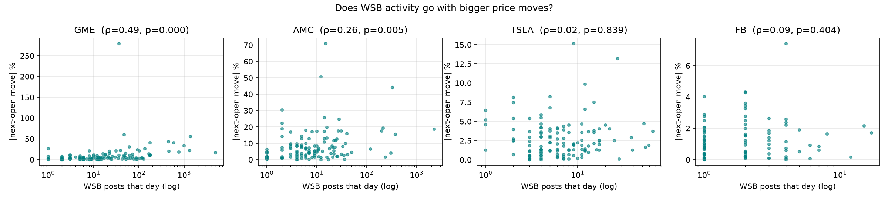
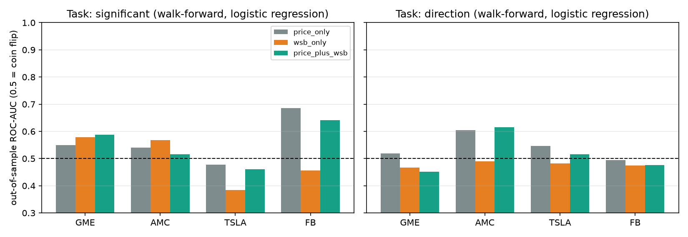
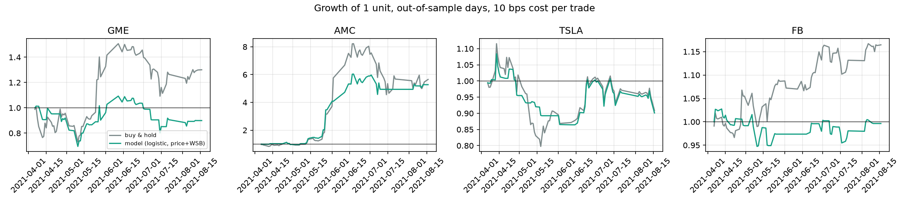

# Predicting Market Volatility from Reddit's WallStreetBets

**UE24CS352A Machine Learning | Mini-Project**

This project re-implements and extends *"Predicting market volatility and building short-term trading strategies using data from Reddit's WallStreetBets"* (Rammoorthy, Nirghin & Raghunathan, Stanford CS229).

## Problem Statement
In January 2021, posts on the subreddit r/WallStreetBets (WSB) drove the GameStop "short squeeze". We ask:

1. **Direction:** Can the content of WSB posts (sentiment, score, comments, length) predict whether a stock's **opening price on the next trading day** will be higher than on the day of the post?
2. **Volatility:** Can WSB activity predict **how much** a stock will move?
3. **Trading:** Can these predictions be turned into a short-term trading strategy that beats simply holding the stock?
4. **Added value:** Does WSB activity tell us anything **beyond what past price volatility already tells us**, when tested strictly out-of-sample with no look-ahead?

Stocks studied: **GME** (GameStop), **AMC** (AMC Entertainment), **TSLA** (Tesla), **FB** (Facebook / Meta).

## Dataset
| Source | Description | How it is obtained |
|---|---|---|
| [OpenML #43373: Reddit-WallStreetBets-Posts](https://www.openml.org/d/43373) | 53,187 WSB posts (title, score, id, url, comms_num, created, body, timestamp), Jan–Aug 2021 with ~70% in Jan–Feb 2021, CC0 licence. A mirror of the Kaggle dataset `gpreda/reddit-wallstreetbets-posts` used in the paper, which has since been removed from Kaggle. | Downloaded automatically by `src/download_data.py` |
| Yahoo Finance (via `yfinance`) | Daily Open/High/Low/Close/Volume prices for each stock | Downloaded automatically by `src/fetch_prices.py` |

Posts per stock after keyword matching: GME 14,393 · AMC 5,242 · TSLA 1,196 · FB 242.

**Coverage caveats (found while building the daily pipeline).** The scraped data is essentially empty before **28 Jan 2021** (one post between Sep 2020 and Jan 2021), and it has **scraping gaps**: 25 trading days in Feb–Aug 2021 have fewer than 20 posts for the *whole* subreddit (for example 22 Jul – 2 Aug has none). A gap means missing data, not "nobody talked about the stock", so the daily pipeline drops those days. This leaves **115 usable trading days per stock** (5 Feb – 16 Aug 2021), so every daily result is low-powered.

## Setup
Requirements: Python 3.10+. A GPU is not needed; everything runs on a normal laptop CPU (roughly 10-15 minutes for the full pipeline; `python run_all.py --fast` skips the slowest daily models).

```bash
git clone <your-repo-url>
cd <repo-folder>
python -m venv .venv
# Windows:   .venv\Scripts\activate
# Mac/Linux: source .venv/bin/activate
pip install -r requirements.txt
```

## How to Run
**Option A: one command (recommended)**
```bash
python run_all.py
```
This downloads the data, preprocesses it, makes the plots, builds the labels, trains all models, runs the volatility analysis, and then runs the causal daily evaluation.
If the price files are already downloaded, use `python run_all.py --skip-prices`. For a shorter run add `--fast`.

**Option B: step by step**
```bash
python -m src.download_data          # posts -> data/raw/reddit_wsb.csv
python -m src.preprocess             # clean text, VADER sentiment, features
python -m src.eda                    # exploratory plots
python -m src.fetch_prices           # prices -> data/raw/prices_<STOCK>.csv
python -m src.build_dataset          # join posts + prices, create labels
python -m src.train                                    # direction label, random split (paper's setup)
python -m src.train --split time                       # direction label, chronological split
python -m src.train --label significant --split time   # significant-move label
python -m src.volatility_analysis    # post volume vs size of price moves

# Causal daily evaluation (no look-ahead)
python -m src.build_daily            # one row per trading day -> data/processed/daily_<STOCK>.csv
python -m src.walk_forward           # walk-forward models, ablation, backtest (add --fast to skip RF/MLP)
python -m src.daily_correlation      # attention vs size of the next move, controlling for past volatility
```

**Tests** (including a check that the daily features cannot see the future):
```bash
python -m pytest -q
```

**Live demo: predict from a new post**
```bash
python -m src.predict --stock GME --text "GME to the moon, diamond hands" --score 500 --comments 100
python -m src.predict --stock GME --text "GME to the moon, diamond hands" --score 500 --comments 100 --label significant --split time
```

Replay any day with the daily model. It is trained only on earlier days, then compared with what really happened:
```bash
python -m src.predict_daily --stock GME --date 2021-05-12
```

**Outputs**
- `results/`: accuracy tables (`results_*.csv`), trading backtests (`strategy_*.csv`), the volatility correlation table (`volatility_correlation.csv`), the daily-pipeline tables (`daily_*.csv`), and plots (`*.png`)
- `models/`: trained models used by `src/predict.py`

## Approach
**1. Preprocessing.** Drop missing titles, convert text to lowercase, and remove @handles, URLs, special characters, emojis and single characters. Match each post to the stocks it mentions by keyword (for example "gme" or "gamestop").

**2. Features (7 per post, as in the paper).** These are post score, number of comments, post length (words), VADER positive / neutral / negative sentiment, and a bias term (a column of 1s). Features are standardised using the training set only.

**3. Labels.** Each post is mapped to the first trading day on or after its date. Weekend posts go to Monday.
- *Direction:* 1 if Open(next trading day) > Open(post day)
- *Significant move:* 1 if \|Open(next)/Open(today) − 1\| is greater than that stock's median daily move (GME 4.2%, AMC 5.4%, TSLA 2.3%, FB 1.0%)

**4. Models.**
- Random baseline and majority-class baseline (always predict the most common training label)
- **Logistic regression solved with Newton's method**, written from scratch in NumPy: θ ← θ − H⁻¹∇J, with a small L2 term for numerical stability
- **Neural network**: 3 hidden layers × 256 units, ReLU, sigmoid output, Adam (lr = 0.001), 30 epochs, batch size 16 (64 for GME and TSLA)

**5. Evaluation.** An 80/10/10 train/validation/test split, done in two ways:
- *Random split* (as in the paper)
- *Chronological split*: train on earlier days, test on later days, never splitting one day across sets. This avoids leaking future information.

**6. Volatility analysis.** For each trading day, compute the Spearman correlation between the number of WSB posts and the size of the next open-to-open move, on the same day and with the previous day's posts (a true forecast).

**7. Trading strategy.** On each test day, a majority vote of that day's post predictions decides whether to buy at the open and sell at the next open, or stay in cash. It is compared with always holding the stock.

**8. Causal daily pipeline (added to fix the weaknesses of the post-level setup).** The post-level setup pairs a post written *during* trading day d with the move from the open of d to the open of d+1, so part of that move has already happened when the post is written, and thousands of posts on one day share a single label. The daily pipeline (`src/build_daily.py`, `src/walk_forward.py`) fixes this:
- *One row = one trading day T*, with everything known **before the open of T**. Posts count only if dated before T (weekend posts go to Monday, a Wednesday post goes to Thursday). Price features use data up to the **previous close** only, so they never depend on T's opening price.
- *Features.* Price: log recent volatility (5 and 20 day), log intraday range, last return, 5-day momentum, volume ratio, and the log of the typical recent move that the label is measured against. WSB: log post count, 5-day average, **attention shock** (today's count vs the trailing 20-day average), log comments, log score, mean positive / negative sentiment.
- *Targets.* "Significant move" = |next open-to-open move| above the median of the **previous 60 days** (the original used the full-sample median, which includes the test period); "direction"; and log |move| for a regression.
- *Walk-forward evaluation.* Train on days [0, t), predict the next 5 days, refit, repeat. The first 40 days are never predicted, which leaves **75 out-of-sample days per stock (6 Apr – 16 Aug 2021)**. Scaling is fitted on the training window only.
- *Ablation.* Every model is run with `price_only`, `wsb_only` and `price_plus_wsb` features. Past volatility is the strongest known predictor of future volatility, so WSB only counts if it improves on `price_only`.
- *Models.* A majority-class baseline, our own Newton's-method logistic regression (class-balanced), gradient-boosted trees, random forest, and a small neural network with weight decay (the paper's 3x256 network would memorise ~100 rows). Ridge and gradient boosting for the regression.
- *Metrics for imbalanced data.* Balanced accuracy, F1, MCC, ROC-AUC, PR-AUC, a label-permutation p-value for the AUC, and a **moving-block bootstrap 95% CI** for the AUC gain from adding WSB features (blocks of 5 days keep the autocorrelation). Regression is scored by out-of-sample R² against "always predict the training mean".
- *Trading backtest.* Long from today's open to the next open if P(up) >= 0.5, otherwise cash, with a **10 bps cost per entry/exit**, reporting total return, Sharpe ratio and maximum drawdown against buy-and-hold on the same days.

## Results

### 1. WSB activity vs volatility (post-level pipeline, original analysis)
| Stock | Same-day ρ | p-value | Previous-day ρ (forecast) | p-value |
|---|---|---|---|---|
| GME  | 0.49 | < 0.001 | 0.49  | < 0.001 |
| AMC  | 0.26 | 0.005   | 0.16  | 0.077   |
| TSLA | 0.02 | 0.84    | 0.05  | 0.55    |
| FB   | 0.09 | 0.40    | −0.04 | 0.70    |

More WSB posts go with **bigger price moves** for the meme stocks GME and AMC. For GME, the previous day's post count also predicts the next day's move size. TSLA and FB show no link. Neither post volume nor sentiment is significantly related to price **direction** for any stock.



### 2. Predicting direction from individual posts (post-level pipeline, chronological split)
| Stock | Majority baseline | Logistic regression | Neural network |
|---|---|---|---|
| GME  | 0.553 | 0.553 | 0.553 |
| AMC  | 0.648 | 0.521 | 0.363 |
| TSLA | 0.612 | 0.612 | 0.612 |
| FB   | 0.500 | 0.500 | 0.462 |

No model beats the majority-class baseline, so post-level features do not predict up/down moves.
With a **random** split, accuracy looks higher (for example AMC NN 0.745 against a 0.602 baseline). This is data leakage: about a third of GME posts were made on a single day (29 Jan 2021), and posts from the same day share one label. A random split puts posts from the same day into both train and test, so the model memorises the day instead of learning a general pattern.

### 3. Trading strategy (post-level pipeline)
A strategy based on post-level direction predictions did not beat simply holding the stock on the chronological test period.

*Caveat for sections 1-3:* the same-day correlations in section 1 mix posts written after the open with the move they coincide with, so they show association rather than forecasting. Section 4 re-tests the question causally.

### 4. Causal daily evaluation (no look-ahead, walk-forward)

**(a) Does the number of posts before the open relate to the size of the next move, controlling for past volatility?** Rank correlations of log post count with log |next open-to-open move|; the partial version removes the rank effect of past volatility (5/20-day volatility and previous-day range) from both variables.

| Stock | All days: ρ | Partial ρ | p | After first 40 days: partial ρ | p |
|---|---|---|---|---|---|
| GME  | 0.46 | **0.36** | 0.0001 | **0.40** | 0.0005 |
| AMC  | 0.14 | 0.15 | 0.11 | 0.04 | 0.73 |
| TSLA | 0.05 | 0.00 | 1.00 | 0.02 | 0.90 |
| FB   | 0.07 | 0.04 | 0.66 | −0.07 | 0.55 |

For GME, the posts written *before* the open carry information about the next move's size **beyond past volatility**, and the effect survives when the unusual squeeze weeks are excluded. It does not show up for AMC, TSLA or FB. The attention *shock* and sentiment-vs-direction relationships are not significant after allowing for multiple comparisons (full table: `results/daily_correlation.csv`).

**(b) Walk-forward classification (logistic regression, 75 out-of-sample days).** ROC-AUC, where 0.5 is a coin flip, and the AUC change from adding WSB features to the price features (95% block-bootstrap CI):

| Stock | Task | AUC price only | AUC price + WSB | Gain from WSB [95% CI] |
|---|---|---|---|---|
| GME  | significant move | 0.550 | 0.588 | +0.038 [−0.044, +0.153] |
| AMC  | significant move | 0.541 | 0.516 | −0.025 [−0.120, +0.058] |
| TSLA | significant move | 0.477 | 0.460 | −0.017 [−0.116, +0.102] |
| FB   | significant move | 0.685 | 0.641 | −0.044 [−0.114, +0.050] |
| GME  | direction | 0.519 | 0.452 | −0.067 [−0.171, −0.010] |
| AMC  | direction | 0.605 | 0.616 | +0.011 [−0.082, +0.096] |
| TSLA | direction | 0.546 | 0.516 | −0.029 [−0.142, +0.061] |
| FB   | direction | 0.494 | 0.476 | −0.018 [−0.109, +0.040] |



- Accuracy is not the headline metric because it is misleading here: the majority baseline scores 44-61% depending on stock and task, and balanced accuracy of the baseline is ~0.5.
- Out of **96** classification experiments (4 stocks x 2 tasks x 3 feature sets x 4 models), **5** reach AUC p < 0.05. Chance alone predicts about 4.8. Two of the five are FB with price-only features (volatility persistence in a large, normally-behaved stock, which is plausible); none uses WSB features alone.
- The CI of the WSB gain includes 0 in 7 of the 8 logistic cases. For GME direction, adding WSB features **hurts** (the CI is below 0), which is typical of overfitting ~100 rows with 15 features.
- One of 32 gain comparisons (GME significant move with gradient boosting, +0.088, CI [0.021, 0.215]) excludes 0 in the helpful direction. With 32 comparisons, about 1-2 such results are expected by chance, so we treat it as suggestive only.

**(c) Regression of the size of the move (log |move|).** Out-of-sample R² against the training-mean baseline: the only clearly positive result is GME with **WSB-only** features and ridge regression (R² = 0.22, Spearman ρ = 0.25, p = 0.03). Adding price features removes it (R² = 0.04), and every AMC, TSLA and FB model has R² ≤ 0, i.e. it is no better than predicting the average. This agrees with (a): GME attention has some signal about move size, but too little data to build a reliable model on top of it.

**(d) Trading backtest (logistic regression, price + WSB features, 10 bps cost, 75 days).**

| Stock | Strategy return | Buy & hold | Strategy Sharpe | Buy & hold Sharpe | Strategy max drawdown | Buy & hold max drawdown |
|---|---|---|---|---|---|---|
| GME  | −10.1% | +30.1% | −0.09 | 1.34 | −31% | −28% |
| AMC  | +427.5% | +465.2% | 4.05 | 3.64 | −24% | −45% |
| TSLA | −9.9% | −9.1% | −0.83 | −0.46 | −20% | −29% |
| FB   | −0.4% | +16.5% | 0.03 | 2.03 | −8% | −7% |



Across all 48 model/feature-set strategies, only 9 (19%) beat buy-and-hold on total return. Eight of them are TSLA, which fell over the period, so staying in cash part of the time helped. The ninth is an FB WSB-only neural network (+18.9% vs +16.5%), one lucky result among 48. AMC's logistic strategy had a better Sharpe ratio and smaller drawdown than holding but a lower return, over a period in which AMC rose about 5x because of one squeeze; with 75 days this is not distinguishable from luck.

Permutation importance (`results/daily_importance.png`) is dominated by noise on a ~35-day test window: many features have *negative* importance, meaning shuffling them improves the score, which again points to overfitting rather than usable signal.

## Conclusions
- **Direction is not predictable** from WallStreetBets text or activity. In no stock does any model beat a coin flip or the majority baseline by more than chance allows: the one direction result with p < 0.05 (AMC, AUC 0.62, p = 0.048) is one of 96 tests, where about 5 are expected by luck.
- **Size of the move: a modest GME-only signal.** For GME, the number of posts written before the open is related to the size of the next day's move, even after controlling for past volatility and excluding the squeeze weeks (partial ρ ≈ 0.4). It is not visible for AMC, TSLA or FB. With ~75 test days it did not translate into a model that reliably beats the baselines or a profitable strategy.
- **Evaluate honestly.** Accuracy must be compared against the majority-class baseline and reported with balanced metrics. A random split overstates performance on this data because of same-day leakage, and so does any feature or threshold that touches the opening price of the day being predicted. Both were found and fixed here, and the tests in `tests/` check the second one.
- **Past volatility matters more than WSB.** The only consistent out-of-sample signal in the whole study is volatility persistence in FB using price features alone.
- **Future work:** a longer data history (this dataset begins on the squeeze peak), intraday timestamps to separate pre-open from intraday posts, finance-specific sentiment such as FinBERT, and pooling several meme stocks to increase the sample size.

## Limitations (please read before quoting any number)
- **Small samples.** 115 trading days per stock, 75 out-of-sample. Confidence intervals are wide; "no significant effect" does not mean "no effect".
- **Multiple comparisons.** Many models and feature sets were tried. The pre-declared main comparison is the logistic regression with and without WSB features on the significant-move task; everything else is exploratory.
- **One design change after seeing results.** After a first run showed price-only volatility features scoring *below* 0.5 AUC, we found that the "significant" label (relative to a rolling median) and raw volatility features were mismatched. We then log-transformed the volatility features and added the label's baseline as a feature, and we fixed a one-day lag so the threshold does not use the opening price of the predicted day. All reported numbers come from that final version, but it is not a fully pre-registered analysis.
- **Data quality.** Scraping gaps are dropped, not repaired. Timestamps are treated as UTC (the hourly post pattern supports this). Post-level results in sections 1-3 still use the original same-day alignment and a full-sample median for the "significant" label, so read them as a replication of the paper's setup and use section 4 for conclusions.
- **Backtest.** Trades are open-to-open at the quoted open with a flat 10 bps cost, with no slippage, short selling or position sizing.
- **P-values** in (a) assume independent days; volatility is autocorrelated, so they are somewhat optimistic.

## Changes in this version
- New causal daily pipeline with walk-forward evaluation, feature-set ablation, imbalance-aware metrics, permutation and block-bootstrap significance tests, regression task, and a backtest with costs.
- Data coverage handling (start date, scraping gaps) and a label threshold that only uses past data.
- Newton's-method logistic regression now supports class weights and an unpenalised intercept (defaults unchanged; the original post-level results reproduce exactly).
- Gradient boosting, random forest and a regularised small neural network added for the daily task.
- `tests/` with 10 automated checks, including a test that rewrites everything on or after day T and verifies that day T's features do not change, and a check that Newton's method matches scikit-learn.
- New live demo `src.predict_daily`.


## Project Structure
```
├── run_all.py                  # runs the full pipeline
├── requirements.txt
├── src/
│   ├── config.py               # settings: stocks, keywords, features
│   ├── download_data.py        # dataset download (OpenML)
│   ├── preprocess.py           # cleaning, sentiment, features
│   ├── eda.py                  # exploratory plots
│   ├── fetch_prices.py         # Yahoo Finance prices
│   ├── build_dataset.py        # join posts + prices, post-level labels
│   ├── models.py               # baselines, Newton logistic regression, neural nets, tree models
│   ├── train.py                # post-level training, evaluation, backtest, saves models
│   ├── volatility_analysis.py  # post volume vs volatility (post-level)
│   ├── predict.py              # live demo (post-level model)
│   ├── build_daily.py          # causal daily panel (no look-ahead, scraping gaps removed)
│   ├── walk_forward.py         # walk-forward models, ablation, significance tests, backtest
│   ├── daily_correlation.py    # attention vs move size, controlling for past volatility
│   └── predict_daily.py        # live demo (replay any day with the daily model)
├── tests/test_pipeline.py      # automated checks (python -m pytest -q)
├── data/                       # created when run (not committed)
├── results/                    # tables and plots
└── models/                     # trained models (not committed)
```

## References
1. S. Rammoorthy, K. Nirghin, A. Raghunathan, *Predicting market volatility and building short-term trading strategies using data from Reddit's WallStreetBets*, CS229 Final Report, Stanford University.
2. Reddit-WallStreetBets-Posts, OpenML dataset 43373: https://www.openml.org/d/43373
3. yfinance Python package: https://pypi.org/project/yfinance/
4. C. J. Hutto and E. Gilbert, *VADER: A Parsimonious Rule-based Model for Sentiment Analysis of Social Media Text*, ICWSM 2014.

## Team
| Name | SRN | Contribution |
|---|---|---|
| JINKA NAGA VAMSI | PES1UG24CS201 | Data download, preprocessing, sentiment analysis, EDA, volatility analysis |
| Teammate Name | PES1UG24CSxxx | Price data, labels, Newton's-method logistic regression, neural network, evaluation |
